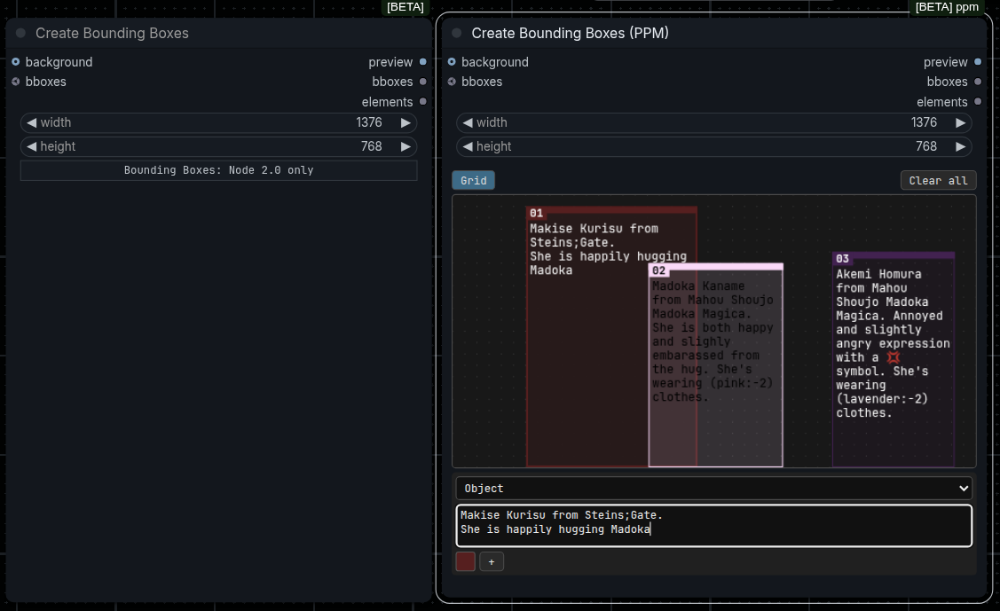

# ComfyUI-ppm

Just a bunch of some random nodes modified/fixed/created by me and/or others. If any node starts throwing errors after an update - try to delete and re-add the node.

You can browse example workflows for MOSS Image and SDXL NoobAI inside ComfyUI's "Browse Templates/Custom Nodes/ComfyUi-ppm" menu. I'll probably add some more examples in future (but I'm kinda lazy, kek).

## Nodes

### CLIP NegPip

> [!TIP]
>
> See "moss+negpip" or "attention_couple+negpip" from ComfyUI's "Browse Templates" menu.

Allows you to use negative weights in prompts. Negative weights can be used in both CFG models (such as SDXL) and Guidance-Distilled models (such as the turbo versions of Anima and MOSS Image) to negate a concept or a trait.

#### Examples

`moss+negpip` - MOSS Image with `Mario wearing a (red:-1) cap. Scene: (simple background:-1), (blurry:-1), castle.` - the cap comes out green and the background stays a detailed castle instead of a plain blurred one:

Three characters placed with `Create Bounding Boxes (PPM)` + `MOSS-Image Layout Prompt` (`moss+regions` / `moss+regions+negpip`) - adding `(pink:-2)` to the middle region and `(lavender:-2)` to the right one strips those tints from the outfits:

| `moss+regions` | `moss+regions+negpip` |
| --- | --- |
|  |  |

Supports:

- SD1
- SDXL
- Anima
- MOSS Image - also enables regular prompt weighting like `(word:2)`

#### Description

Modified implementation of NegPiP by [laksjdjf](https://github.com/laksjdjf) and [hako-mikan](https://github.com/hako-mikan). It uses ModelPatcher instead of monkey-patching, which should increase compatibility with other nodes.

MOSS Image ignores token weights in vanilla ComfyUI, so `CLIP NegPip` re-enables the syntax and applies the weights inside attention instead of on the text embeddings.

You can read more about NegPiP [in the original repo](https://github.com/hako-mikan/sd-webui-negpip). ~~When used together with tag-based models, you should keep all commas inside weight braces (i.e. `(worst quality,:-1.3) (sketch,:-1.1)` instead of `(worst quality:-1.3), (sketch:-1.1),`).~~ Some tag-based models (Illustrious/NoobAI) perform better with commas in braces, while other models (like Anima) perform better with commas outside of emphasis blocks - feel free to experiment.

> [!NOTE]
> `CLIP NegPip` is compatible with:
>
> - [ComfyUI prompt control by asagi4](https://github.com/asagi4/comfyui-prompt-control/)
> - [Advanced CLIP Text Encode extension by BlenderNeko](https://github.com/BlenderNeko/ComfyUI_ADV_CLIP_emb)
>
> `CLIP NegPip` is **incompatible** with:
>
> - [smZ Nodes by shiimizu](https://github.com/shiimizu/ComfyUI_smZNodes) (ComfyUI prompt control can replace most of its functionality)

### AttentionCouplePPM

> [!TIP]
>
> Connect this node after other model patches (such as `CLIP NegPip`, `EasyCache`, `LazyCache`, etc.).
>
> See "attention_couple+negpip" and "attention_couple_with_global_prompt" from ComfyUI's "Browse Templates" menu.

> [!NOTE]
> You can also use the version from [ComfyUI prompt control](https://github.com/asagi4/comfyui-prompt-control/) ([doc](https://github.com/asagi4/comfyui-prompt-control/blob/master/doc/attention_couple.md)) - it has a convenient prompt-based approach that doesn't require to add new `cond`/`mask` nodes for each new region.

Supports:

- SD1
- SDXL
- Anima

Modified implementation of AttentionCouple by [laksjdjf](https://github.com/laksjdjf) and [Haoming02](https://github.com/Haoming02), made to be more compatible with other custom nodes.

Inputs for new regions are managed automatically: when you attach cond/mask of a region to the node, a new `cond_` / `mask_` input appears. Link `base_cond` input to the `positive` conditioning used in `KSampler`/`SamplerCustom`.

You can use multiple `LatentToMaskBB` nodes to set bounding boxes for `AttentionCouplePPM`. The parameters are relative to your initial latent: `x=0.5, y=0.0, w=0.5, h=1.0` will produce a mask covering the right half of the image.

You can adjust mask values to set region strength and use `ConditioningSetAreaStrength` to increase/decrease conditioning strength.

### Create Bounding Boxes (PPM)

Vibecoded port of ComfyUI's `Create Bounding Boxes` node with a box editor that also works with **Nodes 2.0 disabled**.

The stock box editor is a Vue-only widget: with Nodes 2.0 turned off, the classic canvas shows just a placeholder and the boxes cannot be edited. This node keeps the same inputs and outputs (`preview`, `bboxes`, `elements`) and adds a DOM widget editor for the classic canvas: draw/move/resize boxes with grid snapping, per-box type (object/text), text, description and color palette. With Nodes 2.0 enabled the stock Vue editor is used and the DOM editor stays hidden.

- When `background` is connected, the canvas background and `width`/`height` are taken from the image after the node has run once.
- `width`/`height` accept links (e.g. `Empty Latent Image (Aspect Ratio)` → `Latent to Width & Height`). The canvas adopts the size the node actually executed with and keeps the boxes in their relative positions in that frame.
- A new value on the `bboxes` input re-initializes the canvas; canvas edits are kept until the upstream value changes again.
- Clicking a box's number badge selects that box and raises it above the others, so a box can be picked out of a stack of overlapping ones.

### Anima Ref (PPM)

Adds `Anima Ref (PPM)` node that can load various Anima reference adapters (placed in `models/loras` folder) and tune their settings. Almost all inputs have a description inside ComfyUI.

Modified implementation of [ComfyUI-Anima-Ref-Adapter by ElectronGirl](https://github.com/ElectronGirl/ComfyUI-Anima-Ref-Adapter) and [SnapRef by 0ppxnhximxr](https://github.com/0ppxnhximxr/SnapRef) that should be compatible with various model patches (i.e. CLIP NegPip) and guiders.

Supported adapters:
- For [circlestone-labs/Anima](https://huggingface.co/circlestone-labs/Anima) - original adapters:
    - [ElectronGirl/anima-ref-adapter](https://huggingface.co/ElectronGirl/anima-ref-adapter)
    - [0ppxnhximxr/snapref-v1a](https://huggingface.co/0ppxnhximxr/snapref-v1a) / [0ppxnhximxr/snapref-v1b](https://huggingface.co/0ppxnhximxr/snapref-v1b)
- For [Gazingstars123/Anima-2.9B](https://huggingface.co/Gazingstars123/Anima-2.9B) - converted adapters (using modified [Anima2.9B-Lora-weight-conversion script by storyAura](https://github.com/storyAura/Anima2.9B-Lora-weight-conversion)):
    - [pamparamm/anima-ref-adapter-2.9B-converted](https://huggingface.co/pamparamm/anima-ref-adapter-2.9B-converted)
    - [pamparamm/anima-snapref-2.9B-converted](https://huggingface.co/pamparamm/anima-snapref-2.9B-converted)

### Attention Selectors

`Model Attention Selector` and `CLIP Attention Selector` nodes, can be used to swap the optimized attention algorithm, such as pytorch (SDPA), sage (SageAttention), xformers, etc., without restarting ComfyUI.

### DynSamplerSelect

Modified samplers from [Euler-Smea-Dyn-Sampler by Koishi-Star](https://github.com/Koishi-Star/Euler-Smea-Dyn-Sampler).

Contains some new samplers: `euler_ancestral_dy`, `dpmpp_2m_dy` and `dpmpp_3m_dy`.

Tweaking `s_dy_pow` may reduce blur artifacts (optimal value is `2` for `euler_*` samplers and `-1` for `dpmpp_*` samplers, use `-1` to disable this feature).

### CFG++SamplerSelect

Samplers adapted to [CFG++: Manifold-constrained Classifier Free Guidance for Diffusion Models by Chung et al.](https://cfgpp-diffusion.github.io/). Also contains converted samplers from Euler-Smea-Dyn.

Should greatly reduce overexposure effect. Use together with `SamplerCustom` node. Don't forget to set CFG scale to 1.0-2.0 and PAG/SEG scale (if used) to 0.5-1.0.

### Guidance Limiter

Implementation of [Applying Guidance in a Limited Interval Improves Sample and Distribution Quality in Diffusion Models by Kynkäänniemi et al.](https://arxiv.org/abs/2404.07724) as a post CFG function.

Guidance Limiter is also available as a `CFGLimiterGuider` guider node for `SamplerCustomAdvanced`.

### C2FG

Implementation of [C2FG: Control Classifier-Free Guidance via Score Discrepancy Analysis by Gao et al.](https://arxiv.org/abs/2603.08155) as a time-dependent CFG scale: `cfg * exp(growth_rate * (1 - t/t_max))`.

Improves overall image clarity and enhances small details by boosting CFG at later stages of denoising.
Should be compatible with any model that is not CFG-distilled (the node doesn't work when CFG is set to 1.0).

Guidance is equal to the `cfg` from the sampler at the highest noise level and grows to `cfg * e^growth_rate` by the last steps. Set `growth_rate` to `0.0` to disable the schedule (`1.0` is the best value from the paper).

### Temperature Sampling (PPM)

Implementation of [Diversify Diffusion with Temperature Sampling and Variance-Corrective Time Shifting (Li et al., 2026)](https://arxiv.org/abs/2607.10853).

- `gamma` < 1.0 increases sampling diversity, 1.0 disables temperature sampling.
- `start_percent`/`end_percent` sets sampling window.

### Epsilon Scaling (PPM)

Modified version of ComfyUI's `Epsilon Scaling` node with a hacky (and mathematically incorrect) support for v-pred ZSNR models.

### Tile Preprocessor (PPM)

Image preprocessor for ControlNet Tile that doesn't require any third-party libraries (aside from `kornia`, which is a part of ComfyUI's requirements).

### Post-CFG nodes

Post-CFG variants of some nodes - they should have increased compatibility with other CFG-related nodes, making it possible to chain them together:

- `RescaleCFGPost`
- `RenormCFGPost`
- `DynamicThresholdingSimplePost` and `DynamicThresholdingFullPost` (based on [sd-dynamic-thresholding by mcmonkey4eva](https://github.com/mcmonkeyprojects/sd-dynamic-thresholding))

### Empty Latent Image (Aspect Ratio)

Generates empty latent with specified aspect ratio and with respect to target resolution.

### CLIPTextEncodeBREAK

A small lightweight wrapper over `ConditioningConcat` node. It splits prompts into chunks by `BREAK` keyword and produces a single concatenated conditioning.

### CLIPTokenCounter

Counts tokens in your prompt and returns them as a string. You can use `Preview Any` node to display them.

## Hooks/Hijacks

### Schedulers

Adds some schedulers to the default list from ComfyUI by replacing `comfy.samplers.calculate_sigmas` function:

- `ays` and `ays+` from [AlignYourSteps scheduler modified by Extraltodeus](https://github.com/Extraltodeus/sigmas_tools_and_the_golden_scheduler/blob/0dc89a264ef346a093d053c0da751f3ece317613/sigmas_merge.py#L203-L233) - `ays` is the default AYS scheduler (SDXL variant) and `ays+` is just `ays` with `force_sigma_min=True`
- `ays_30` and `gits` schedulers based on [AYS_32 by Koitenshin](https://github.com/AUTOMATIC1111/stable-diffusion-webui/pull/15751#issuecomment-2143648234)
- `beta_1_1` - ComfyUI's beta scheduler with both alpha and beta set to 1.0
